 

 

  

 

### ⚡ Tech Stack

 

## 📊 GitHub Dashboard

 

## 🚀 Projects

  

[`learn_skills`](https://github.com/rachi2006/learn_skills) · [`python_code`](https://github.com/rachi2006/python_code) · [`PYLIB`](https://github.com/rachi2006/PYLIB) · [`java_code`](https://github.com/rachi2006/java_code) · [`DDS-projects`](https://github.com/rachi2006/DDS-projects) · [`DDS-Codes`](https://github.com/rachi2006/DDS-Codes)

 

## 🌐 Connect

 

